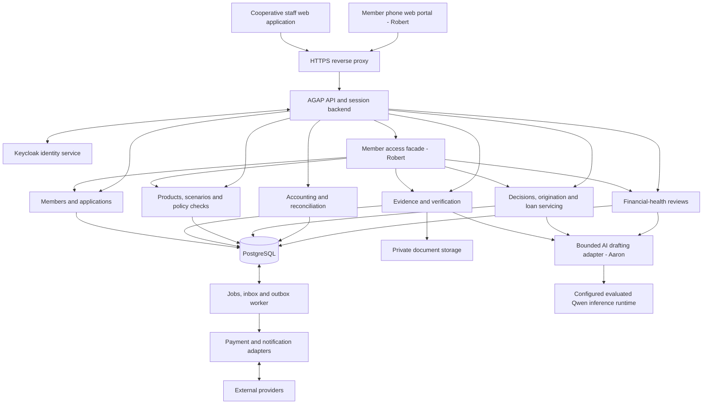
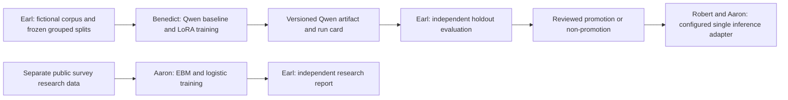

# AGAP production architecture

## VID-02 fictional recording boundary

The development/test review module owns append-only `reviews.prepared_packets`, restricted current-basis reads and the safe recommendation projection. Runtime has no packet-publication permission. Only explicit localhost operator preparation authors packets and accounts. The actual existing recommendation transaction writes a minimal immutable projection through a trigger; member reads do not receive access to the private recommendation body. Existing organization/branch/own-member access checks and normal OIDC sessions remain authoritative. Financial comparison uses the shared engine. No startup seeding, model-serving deployment, lending-authority bypass or production release is introduced. This implementation is a fictional recording aid; see [VID-02](tasks/production/two-minute-recording/IMPLEMENTATION.md).

**Selected constraint amendment, 5 November 2026:** [PLN-05](AGAP_Priority_Review_Plan.md) proposes application review composition, concern checking and escalation. All new records/commands remain written proposals; executable contracts and production authorization are unchanged.

**5C extension:** 29 October 2026. FND-05/CRD-03/QWN-03/EVAL-03 add proposed rubric review interfaces only; numeric policy and executable contracts remain unimplemented.

**Goals extension:** 29 October 2026. FND-04/CRD-02/GOL-01/MOB-02/QWN-02/EVAL-02 are proposed additional implementation packages; executable contracts, data stores and runtime remain unchanged by this document.

**Baseline:** 25 October 2026, Asia/Manila. Updated for member-phone access, bounded AI assistance, Qwen training and separate explainable-model research.

**Status, 26 October:** target design with a supplied [platform/member-intake candidate](AGAP_Platform_Foundation.md) on `feat/robert-member-platform`. Real member access/intake and the domain facade are implemented; lending/evidence/AI/health/accounting services remain unimplemented. [Current evidence](AGAP_Robert_Member_Verification.md) distinguishes real intake from simulated domain rendering. Consuming-owner agreement and live readiness are not claimed.

**Technical review, 30 October:** main `266379a` also supplies GL-01's internal `PostingPort` implementation, EVAL-01 development tooling and a fictional-browser evidence/readiness slice. The [foundation review](AGAP_Foundation_Contract_Review.md) registers the existing accounting migrations and evaluation checks through Robert's shared boundaries. Financial HTTP/capability defaults remain unavailable; actual member evidence/credit/decision/loan/support services, model artifacts, reviewed training release, consuming-owner agreement and live readiness remain pending. No canonical contract version or module-owned source changes in this review.

**Scope authority:** [product solution and priorities](AGAP_Product_Solution.md). Named owners and task progress are in [Assignment.md](../Assignment.md); exact path ownership and delivery gates are in the [delivery plan](AGAP_Delivery_Plan.md). A–D map to Robert, Aaron, Benedict and Earl respectively.

This revision supersedes the earlier staff-first/later-member-channel sequencing. Robert exclusively owns the member portal and its access facade. The later FND-03 candidate implements contract 0.2.0, its generated client/OpenAPI and append-only member migrations 008–010 after the [written proposal](AGAP_Member_Contract_Proposal.md). Shared member-domain/provenance interfaces remain subject to consuming-owner review; default business-domain implementations are unavailable. [Training/evaluation details](AGAP_Model_Training_Plan.md) distinguish Benedict’s Qwen work, Aaron’s research training/inference adapter and Earl’s independent evaluation.

**2 November policy-source note:** the 26 October implementation statements above are historical. Current partial evidence/credit, posting, principal-comparison and evaluation deliveries are recorded in [Assignment.md](../Assignment.md); merged components do not establish an integrated financial path. The [policy-source register](AGAP_Policy_Clarification_Register.md) uses existing source-owned facts, versioned credit configuration, checked assessments and immutable human handoffs. It introduces no service, table, schema or provider. Robert reviews any proposed shared-field change with consuming owners before implementation; unresolved institutional settings block only the affected rule. Draft foundation registration PR #18 remains separate from this documentation amendment.

## 1. Architecture decisions

Build a **modular monolith**: one application backend, one PostgreSQL database, and a worker using the same domain modules. A financial operation can then update the loan subledger and general ledger in one database transaction. Modules have separate owners and public interfaces; they do not need separate services to support parallel development.

| Layer | Selected design baseline | Reason and boundary |
| --- | --- | --- |
| Web application | Retain React, TypeScript, Vite and the existing shared design system | Reuse the working review screens; feature teams do not create another component or token system |
| Backend | Node.js 24 LTS baseline; TypeScript; NestJS modules with its standard HTTP adapter | Keep one implementation language; module boundaries, dependency injection and authorization can be explicit. Pin supported package releases during foundation work rather than inventing version numbers here |
| Database | PostgreSQL 18; SQL migrations; server-side transactions | Relational constraints and transaction integrity for loan and accounting data; no browser-authoritative financial records |
| Identity | Keycloak through OpenID Connect; backend-managed sessions | Free, self-hostable identity service; application permissions and segregation of duties remain server responsibilities |
| Files | Private filesystem adapter for local/single-host deployment; an interchangeable object-storage adapter for later hosting | Original versions, checksums, access control and independent backups; never serve document paths as public assets |
| Background work | PostgreSQL-backed outbox/inbox and jobs, processed by a separate worker process | No extra paid queue required; retry, deduplication and operator-visible failures are part of the contract |
| Member channel | Responsive web portal with a separate member principal and own-record linkage | Robert owns its screens/facade; domain services remain with their existing owners; assisted access remains available |
| Documents and explanations | One reusable bounded AI adapter, source-linked drafts and explicit confirmation; deterministic/manual fallback | Aaron owns the adapter; domain owners validate their prompts/results; no AI financial or decision authority |
| Model training | Offline Qwen3.5-2B LoRA pipeline (Benedict); CPU EBM/logistic research pipeline (Aaron); independent corpus/splits/evaluation (Earl) | Training is outside the transactional backend. Only an evaluated Qwen artifact is eligible for the shared inference adapter; EBM has no lending/member API |
| Deployment | Docker Engine/Compose on Linux; HTTPS reverse proxy; separate development, staging and production configurations | No software subscription is required. Hardware, backups, connectivity, domains and provider transactions can still cost money |

These are project choices, not a claim that a framework supplies financial correctness. Nest's module model supports explicit exports/imports; transaction isolation and row-security behavior must be implemented and tested as designed. [Nest modules](https://docs.nestjs.com/modules), [PostgreSQL transactions](https://www.postgresql.org/docs/18/transaction-iso.html)

## 2. System boundaries

The module boxes belong to the same backend. They are not independently deployed microservices. Identity uses a separate database/schema and credentials; its records are not loan or accounting tables. The worker does not become a second implementation of business rules.

The browser submits commands and displays server results. It cannot set its own actor, organization, reviewer, verified status, policy exception authority, payment settlement or journal balance. Browser storage remains a demo facility; production drafts are saved to the server with visible saved/unsaved state. No real financial payloads or identity tokens are persisted in browser localStorage.

The first deployment serves one cooperative. Organization IDs and branch/assignment scopes remain explicit to prevent accidental cross-context access; this is not a promise of a multi-tenant SaaS release.

### Member access and orchestration

FND-03 introduces a server-established member principal distinct from staff roles. An approved identity-to-member linkage supplies organization/member scope; a submitted member ID, phone number, uploaded image or AI match cannot create that linkage. Enrollment, recovery and linkage changes need an institutionally approved verification process and audit history. No automatic linking by an editable contact field is assumed.

Member routes expose only the caller's applications, cleared document access, permitted options, decisions/acceptances, posted loans/schedules/receipts, reminder preferences and support requests. Extend domain authorization through reviewed member-specific operations/ports; never cast a member as an officer or expose staff searches, CI notes, audit queues or another member's existence. Linkage revocation/expiry is rechecked on reads, writes, downloads and delivery.

Robert's facade owns access/orchestration; evidence/credit, decisions/servicing and monitoring retain their domain commands and tables. Member drafts use server persistence, concurrency and idempotency protections. Initial reminders are in-portal notices from confirmed schedules, not proof of external delivery.

## 3. Modules, data ownership and interfaces

Each module owns its tables and writes them through its public application service. Other modules use a typed port or a published read model; they do not issue writes against another module's tables. Financial orchestration receives a transaction context so module services share the same commit.

| Module | Authoritative data | Public responsibilities |
| --- | --- | --- |
| Identity/platform | Organization, branch, user membership, scoped permissions, sessions, audit events, jobs and idempotency records | Establish actor context, authorize actions, provide transaction and infrastructure adapters |
| Members/applications | Member identifiers, contact/identity references, notices/consents, application metadata, assignment and aggregate revisions | Open and assign applications; preserve member/application history; return authorized workspace views |
| Member portal (Robert) | Member linkage, portal preferences and access/orchestration metadata | Enforce own-record access and call public domain services; all member-phone UI stays with Robert |
| Evidence | Source metadata, file versions, fact revisions, verification attempts and clarification tasks | Record facts and verification outcomes; retain provenance; invalidate affected assessment inputs |
| Credit | Versioned product/policy configuration, available offers, contractual schedules and assessment runs | Generate allowed offers; calculate schedule/cost/cash-flow results; return eligibility and policy checks with reasons |
| Decisions/origination | Recommendations, decisions, approval steps, member acceptance and approved contract snapshots | Enforce authority and prerequisite checks; produce a signed-off release basis and saved explanation |
| Servicing/payments | Loan accounts, immutable schedule versions, disbursement/payment/refund commands, allocations, receipts, settlement events and adjustment proposals | Execute controlled financial workflows; maintain the loan subledger; invoke accounting synchronously for every financial posting |
| Accounting | Chart and posting-rule versions, journals/lines, share-capital subledger, periods and reconciliation records | Validate and post balanced journals; enforce period rules; reconcile cash/bank; produce financial reports |
| Monitoring/reporting | Review schedule, dated member responses, task/action history and read-model freshness | Show repayment facts alongside household circumstances; support staff review without inferring character or automatically changing a loan |
| AI adapter (Aaron) | Provider/prompt provenance and bounded execution metadata | One reusable transport/output envelope; callers retain source validation, confirmation and policy; no direct financial/table/tool authority |

Important cross-module interfaces:

- `ActorContext`: server-established user, organization, allowed scopes, correlation ID and authentication strength; never accepted from request JSON.
- `Credit.assess(inputSnapshot)`: immutable checked input → complete or incomplete result plus engine/configuration versions. Reuse the existing pure domain rules through a deliberate extraction, not a copied calculator.
- `Decisions.authorizeRelease(loanBasis)`: confirms approved, current, accepted and unexpired terms plus the authorized preparer/checker identities.
- `Accounting.post(tx, postingRequest)`: validates source-event uniqueness, approved account mapping, open period and balanced entries; returns the journal ID in the caller's transaction.
- `Servicing.getPosition(loanId, asOfDate)`: principal, accrued components, due/paid amounts and freshness from posted events, not a browser total.
- `PaymentProvider.submit(command, idempotencyKey)` and `getStatus(providerReference)`: distinguish confirmed success, confirmed failure and unknown outcome.
- `DocumentStore`: immutable version put/read/delete-under-retention-policy; no public-path exposure.
- Candidate `MemberActorContext`: verified server linkage and own-record permissions, separate from existing staff `ActorContext`; domain ports explicitly authorize member operations.
- Proposed `AiDraftPort`: approved necessary source excerpts or checked results → untrusted draft with source/origin references; never an accepted fact, decision or calculated amount.
- Proposed evidence draft/confirmation operations: source version, candidate text/value, confirmation/correction actor and time, with independent verification separate.
- Proposed monitoring support-request port: member-confirmed request → staff-review task; servicing alone owns amendment comparisons, approval, acceptance and effective schedules.

The integration owner supplies candidate schemas/ports in `packages/contracts`. Demo/domain types remain in `src/domain/types.ts`. The original `assessCase` implementation now lives in `packages/finance` with `src/domain/assessment.ts` re-exporting it; Aaron owns subsequent finance implementation. This extraction changes no arithmetic or historical fixture.

Aaron implements the single provider adapter in planned module `ai/`. Domain prompts/result validation stay in `evidence/` and `credit/` (Aaron), `decisions/` (Benedict), and `monitoring/` (Earl). Robert owns canonical schema/port edits, dependencies/configuration and registration. Benedict owns planned `models/qwen/` for offline baseline/LoRA/config/artifact handoff; Aaron owns planned `models/explainable/` for EBM/logistic training. Earl’s `evaluation/synthetic/` owns generated sources, independent truth and grouped manifests; `evaluation/explainable/` owns independent research split/evaluation protocols and reports. These are not operational databases or duplicate demo fixture registries. Shared dependencies, manifest/wire schemas and runtime registration remain Robert’s.

### Model training, inference and research separation

QWN-01 consumes Earl's approved training/validation manifest in an offline Python/notebook environment; Earl reserves the grouped holdout for final pretrained/tuned/checklist evaluation. Benedict supplies a pinned base/processor revision, LoRA artifact/config/checksum, dataset/split hashes, resource limits and reproducible run/model card. No training script can query operational member/loan tables or mutate application facts. Large weights remain outside Git in an approved artifact location.

Aaron's AI-01 adapter consumes a configured compatible inference runtime, not a training notebook. Runtime selection/hosting is a separate integration decision: free Colab training does not provide a dependable always-on backend. The same source-validation, output-schema, confirmation and manual-fallback rules apply to both pretrained and tuned artifacts. A training result alone never enables a capability flag or replaces the configured baseline. Earl records reviewed promotion/non-promotion evidence; Robert wires the eligible release with Aaron.

XAI-01 trains an EBM and logistic-regression baseline offline on a separately documented public-research dataset. It models reported emergency-fund difficulty with codebook/weight/missingness/leakage review, not future loan default or a validated member score. Earl independently evaluates returned artifacts. The research report has **no data path into member views, assessments, decisions, support priority or financial commands**. Any operational predictive use needs a separate approved design and relevant validation.

Only the inference path can produce application drafts; confirmation/verification and deterministic calculations remain separate. The research branch ends at an offline report. Data/protocol handoffs precede training; final artifact evaluation follows it, avoiding a circular dependency between whole tasks.

## 4. Data model and versioning

Use normalized tables for operational records and append-only historical records for decisions and financial events. A workspace response is a projection, not a single mutable JSON record that a client can overwrite.

| Record family | Required references and invariants |
| --- | --- |
| Member/application | Stable IDs, organization, branch, assignment, concurrency version, assessment-input version and recorded timestamps |
| Member linkage/preferences | Trusted issuer/subject linkage to the approved member record, linkage status/history and disclosure/reminder choices; no client-controlled scope |
| Evidence/source | Application, fact category, nullable value, currency when monetary, effective/cash dates, original source/file version, evidence status and verification status |
| AI draft/confirmation | Source/version and pinned base/adapter artifact/prompt/schema origin, candidate/confirmed status, confirming actor/time/correction and limitations; extraction is not independent verification |
| Model release manifest (offline) | Base/processor/artifact checksums, license, dataset/split/config hashes, run/evaluation versions and promotion outcome; no member records or financial authority |
| Irregular expense | Confirmed relevance, nullable amount/date until supplied, source, category, occurrence/explicit recurrence assumption and modeled horizon; no implicit zero or inferred future fact |
| Product/policy/offer | Immutable published version, validity/effective dates, approved formula and rounding configuration, permitted terms, authority/verification requirements and account mappings |
| Assessment | Exact input snapshot, assessment-input version, policy/offer/engine versions, modeled horizon, checked results, unresolved issues and calculation hash |
| Decision/acceptance | Assessment/recommendation references, actual approvers and authority, rationale, exceptions, snapshot, member acknowledgment and document versions |
| Loan/schedule | Approved contractual basis, disbursement condition, schedule version, status and concurrency version; historical schedules retained |
| Financial event | Unique business-event identity, amount/currency, actual instrument/provider reference, effective date, recorded time, authorizations, allocations and reversal references |
| Journal | Source financial event, posting-rule version, effective/recorded dates, period and balanced immutable lines |
| Health review | Loan/member reference, review/as-of dates, recorded responses and explicit unavailable values, source, staff action and next review; separate from credit decision snapshots |
| Support request | Confirmed shared account, submitted/assigned/reviewed state and action history, position freshness and optional servicing-proposal reference; request status does not alter obligations |
| Member goal/guidance (monitoring) | Member-owned goal/version, purpose/target/deadline, consent, dedicated funds, confirmed inputs, reviewed content and immutable guidance/reviewer history; no money movement |
| Goal planning run (credit) | Exact goal/fact/position/catalogue versions, as-of date, horizon, dated assumptions, protected allocations, integer-centavo calculations, incomplete/infeasible/conditional result and engine version |
| Savings/investment catalogue (credit) | Institutionally approved version, availability, eligibility, liquidity/lockup, minimums, fees, risks, return disclosures, authority and review/expiry; no invented product or guaranteed return |
| 5C rubric/assessment (credit) | Source institution/product/date, approved criterion/weight/applicability/missingness rules and version; immutable evidence/offer bindings, deterministic scores and criterion trace; no probability field |
| 5C finding/handoff review | Source-linked AI candidate versus accepted discretionary finding, confirming actor/rationale, review/as-of/coverage/stale state and decision-snapshot references; no inferred personality or eligibility authority |
| Conflict declaration | Case/actor declaration, applicable restriction, reassignment/recusal and resolution evidence; separate from eligibility and calculation |

Concurrency version and assessment-input version have different jobs. Every application mutation changes its concurrency version. Only changes affecting evidence, verification readiness, policy applicability or available terms change the assessment-input version. Saving a reminder must not invalidate a valid assessment; changing verified income must.

Recommendations reference the assessment-input version and assessment ID. At decision time the server checks both against the current inputs, current authorization and applicable policy. Publishing a policy creates a new version; it never edits old snapshots. A material policy/offer change requires an explicit rebind and renewed assessment when applicable, not silent recalculation of a recorded decision.

Material changes after approval hold an unreleased loan for renewed review. Changes after disbursement do not rewrite the contract or historic decision: create a health-review, dispute or authorized amendment/restructure workflow.

Missing, conflicting, stale and unknown values remain distinguishable from zero. Document provenance and independent verification are separate dimensions. A scan result or successful OCR extraction does not prove authenticity.

### Irregular-expense flow

1. Evidence supplies cleared, authorized source versions or voluntary member text to the bounded adapter. AI returns candidates/questions without changing the assessment.
2. The member confirms/corrects relevance, amount, date and recurrence. Staff may record an assisted confirmation with the actual actor/method. Neither action marks the claim independently verified.
3. Evidence records accepted facts and provenance; required unresolved amounts/dates stay unavailable. Material accepted changes invalidate pending assessments/reviews while historic snapshots remain intact.
4. Credit uses the existing engine after its reviewed extension, with explicit dated inputs and a displayed horizon. The first new scenario covers an irregular expense beyond the original demo cycle; future income/recurrence is not silently invented.
5. Compare permitted offers from checked results. Count a cost once: a reserve presentation and eventual dated spending cannot both be deducted, and repeated source mentions cannot duplicate obligations.

The unchanged browser model still covers one cycle and retains its historical oracles. New multi-cycle results need independent expectations. Document quantity, asset ownership, AI confidence and draft completeness do not automatically raise a loan limit or become predictive default scores.

### Institution-rubric 5C assessment and proposed FND-05 boundary

The [FND-05 field-level proposal](AGAP_5C_Review_Contract_Proposal.md) specifies candidate records, operations, independent review states, score encoding, immutable basis/trace and acceptance examples. It is a receiving-owner review draft, not an executable schema revision or approved institutional rubric.

Implement the [5C requirements](AGAP_Product_Solution.md#ai-assisted-5c-review-and-explainable-handoff) in existing evidence/credit/decision modules. Robert proposes FND-05 source/criterion/rubric/result/review/trace ports and integration; Aaron owns CRD-03 rubric configuration, deterministic scoring and staff 5C UI in credit; Benedict owns QWN-03 bounded analysis/explanation and decision-handoff integration through the existing AI adapter; Earl owns EVAL-03 independent data/protocol/final review. No second AI provider, calculator, member-score service or outcome-prediction model is added.

1. Evidence provides authorized current facts, verification status and source references. Qwen drafts per-C evidence/criterion mappings, contradictions/questions and source-linked findings. Its output remains untrusted; it cannot define weights, fabricate rating rules or authenticate sources. Discretionary criterion interpretations require staff acceptance before reviewed scoring.
2. Credit binds a versioned institution/product-specific approved rubric to a fixed evidence/offer/assessment snapshot. Objective values come from source-owned facts and the existing finance engine. Compute configured weighted/normalized scores in deterministic fixed-point score units, with explicit bounds/denominators/rounding and a per-criterion trace. Keep money in integer centavos. No configured rubric or missing required evidence yields unavailable/clarification, not zero or a guessed denominator. Not-applicable criteria require a documented product/rubric rule.
3. Qwen can summarize only the supplied accepted trace/results and unresolved matters. Validate evidence references, criterion IDs, score values, explanations and statements of review/coverage. Unsupported factors, invented scores/probabilities or claims that a high score overrides a cash shortage are rejected; expose the trace/template/manual path if AI is unavailable.
4. Decision services consume the reviewed 5C record with the checked offer/assessment and source/rubric/input versions. The officer independently recommends and the separate authorized reviewer decides. A model output never writes a decision or grants an exception. Changes to evidence, rubric applicability or terms mark affected pending findings/scores/handoff stale and require recomputation/review; immutable historic records remain intact.

Proposed records/ports carry rubric provenance and approval/effective version, category/criterion, possible/awarded points and weight, required/applicable/unknown state, accepted source values, discretionary reviewer reasons, verified status separately, arithmetic and aggregate rule if any, score/review/coverage state, as-of/horizon and model/prompt/engine origin. A field labeled rubric percentage cannot be serialized or displayed as repayment probability or AI confidence. Evidence coverage has a separate definition and denominator. Apply normal server scopes, version checks, audit/access history and member correction/explanation rights; the first panel is a staff view, not a new public member ranking.

Public references establish a review framework only; no current approved numeric rubric is supplied. Any fictional illustration is labeled and isolated from live configuration. EBM/logistic research keeps its existing offline emergency-funds target and has no data path here. Future credit-probability modeling requires a separate approved target/data/calibration/evaluation/architecture proposal; explaining a generated score does not validate it.

### Goal-guidance flow and proposed FND-04 boundary

The [FND-04 field-level proposal](AGAP_Goal_Guidance_Contract_Proposal.md) specifies goal/choice/basis/planner/catalogue/guidance/review records and scoped operations. It preserves private investment drafts, explicit unavailable values and current-version checks; no route, permission mapping, product or executable contract is activated by the proposal.

The [product requirements](AGAP_Product_Solution.md#member-goals-savings-and-cooperative-product-guidance) govern what guidance may say. Add the capability to existing modules rather than another autonomous agent service: monitoring owns goal consent/state, reviewed educational references, domain prompts and advice-review history (Earl); credit owns catalogue/configuration and the single deterministic planning extension (Aaron); the member portal owns own-record UI/orchestration (Robert). Benedict supplies QWN-02 artifacts in the existing training path. Qwen inference uses Aaron's one adapter. EBM/logistic outputs remain outside this flow.

1. An authorized member or identified assisting staff actor creates/confirms a goal and proportionate data-reuse choices. Resolve facts from source-owned projections with dates, verification status and explicit unavailable values, not copies that silently diverge. Declining guidance grants no adverse credit inference.
2. Monitoring requests a credit planning run against a fixed snapshot of confirmed facts, effective servicing position, goal and reserve assumptions; approved catalogue versions are required only for product scenarios. A no-product goal baseline does not require an available catalogue. Credit checks integer/date bounds, horizon coverage, duplicate allocations, fees/liquidity and candidate restrictions using the existing engine. It returns incomplete, infeasible or conditional scenarios with reasons. It cannot infer future income or count one peso twice.
3. Monitoring passes the minimum authorized checked result, approved content and eligible catalogue references to the existing AI adapter. The model can draft explanations/questions and product considerations but cannot generate authoritative money values, rewrite product rules, call financial commands or make a suitability determination. Backend orchestration, not the model, executes planning operations. Validate sources, amounts, dates, product IDs, restrictions and output status before showing a draft; reject inconsistent output and offer a template/manual path.
4. General member-visible budget/goal drafts retain their status and correction route. Product-specific investment drafts are staff-only until authorized suitability review; members receive a pending-review status and neutral educational/product facts, then any reviewed personalized recommendation. Preserve reviewer reasons, member choice, content/catalogue/results versions, expiry and any limitations. Neither an administrator role alone nor a model release gives advisory authority.
5. Material changes to income, needs, goal funding, loan position or product conditions mark affected pending plans/recommendations stale. Recalculate and renew any required review; preserve earlier snapshots. An ordinary goal edit does not itself rewrite a loan assessment or contract. Changed household facts follow the existing evidence/assessment invalidation rules when actually adopted there.

FND-04 proposes own-record goal commands/read models, a checked goal-planning port, approved-catalogue lookup, domain-specific AI draft references and advice-review operations. These are not added to candidate 0.2.0 by documentation. Include expected versions, purpose/consent, as-of/horizon, input/result/engine/catalogue/content/model provenance, explicit missing-data reasons and separate review/publication status. Use server-established member/reviewer scopes, idempotent creates/retries, normal optimistic concurrency, revoked-linkage checks and private source access. Do not add a second provider client, finance package, fixture registry or owner-independent goal database.

Saving or accepting a plan is a planning event, not a servicing payment, share-capital contribution or journal. No goal service can write servicing/accounting tables, reserve real funds or execute investments. Actual transactions remain in the separately authorized cooperative process; future transaction integration needs its own approved boundaries. Projection earmarks conserve household money while exposing reduced unallocated/accessibly spendable funds. The no-return baseline and any uncertain-return scenario are distinguishable; missing expected-return data is not a promised zero and required gains cannot justify feasibility. Keep reviewed educational sources/versioning and source-reference checks separate from user-provided documents, which remain untrusted data.

## 5. Financial invariants and transaction boundaries

### Money and dates

- Currency is explicitly PHP for the first product family. Money is integer centavos with validated safe-integer limits at every API/domain boundary and compatible database constraints. PostgreSQL `bigint` conversion must be checked; do not silently coerce an arbitrary database integer into JavaScript Number.
- Interest/rate calculations use exact fixed-point or rational intermediate values and an approved rounding convention. Binary floating-point operations must not decide a posted centavo. Schedule generation tests cover final-instalment residuals and principal conservation.
- Products specify rate method, day-count basis, grace/holiday handling, fees, prepayment treatment, penalties and allocation order. Unconfigured rules block that product's activation.
- Calendar cash dates use the cooperative's business timezone, initially Asia/Manila. Recorded-at values are UTC instants. Keep contractual due date, value date, posting date and event-received time distinct.
- Preserve the existing monthly/daily calculation semantics and independent fixture oracles. A multi-cycle projection labels its assumptions; it is not a promise of future cash or a default probability.

### Accounting

Every posted financial event has a balanced journal: debits equal credits, at least two valid lines, one currency and one organization, valid accounts and an open accounting period. Enforce these conditions in the posting service and with database permissions/constraints or deferred validation; a browser check is insufficient.

The loan subledger, allocations, GL posting, command status and audit event commit atomically. Notifications and reporting updates use an outbox written in that same transaction and may follow later. Do not post the GL asynchronously after reporting a loan payment as fully posted.

Use a single transaction coordinator and a canonical lock order: accounting period, affected loan IDs in sorted order, then financial command. Period close takes the conflicting period lock and verifies no unresolved posting/reconciliation issues. All posting paths obey the same ordering.

Journals and posted allocations cannot be edited or deleted by ordinary application roles. Corrections create linked reversals and replacement events. Closed-period corrections use an authorized open-period adjustment that preserves original references; reopening a period is separately authorized and audited. Hashes or append-only permissions do not make records immune to a database administrator; operational access and independent backups remain necessary.

The accountant must approve the chart, recognition and posting rules, including accrued interest, fees, provisions, write-offs, recoveries, share capital, reserves and reporting mappings. Total contractual repayments are not automatically all recognized income at origination. Versioned templates and manual authorized journals cover approved accounting treatments; automated tax or impairment models are not assumed.

### Disbursement and repayments

Loan approval, member acceptance, authorization to release, actual settlement and accounting posting are separate events. A first-release invariant prevents multiple principal releases for the same loan. Multi-tranche lending requires a later explicit product specification.

1. A preparer creates a release/payment/refund command from server-checked terms. A distinct authorized checker approves the consequential action.
2. The command is durable before an external provider is called. The same logical command always uses the same provider idempotency key.
3. A timeout produces `unknown`, not failure. Reconcile status and references before any retry that could move money. A provider without sufficient idempotency/status controls cannot be enabled for unattended transfers.
4. Record confirmed external settlement durably in an inbox before processing it. If GL posting fails, keep an explicit confirmed-but-unposted exception for reconciliation; never lose or resend the real-world movement.
5. Apply a confirmed movement to the loan subledger and GL in one transaction. Deduplicate by the underlying provider transaction/business event as well as webhook event ID, since multiple notifications may refer to one movement.
6. Cash/bank manual workflows require actual voucher/receipt evidence and separate confirmation. They do not pretend to electronically move funds.

Payment allocation follows the approved schedule/product rule. Partial payments, early payments, penalties, reversals and refunds retain their event history. Excess receipts go to an identified unapplied-cash/liability workflow; do not silently create a negative principal balance. Written-off debt and recoveries retain separate authorized accounting events. A restructure creates new approved schedule terms, not an overwrite of the original obligation.

Balances and arrears are computed from posted events as of an explicit date, including reversals and grace rules. Pending or stale information remains labeled. Member-reported financial strain is a separate observation and never changes the ledger by itself.

## 6. Workflow states

| Workflow | Required states and guards |
| --- | --- |
| Application review | Draft → evidence review → clarification or assessment ready → recommended → reviewer action. Approval/decline require current prerequisites; clarification remains possible with incomplete evidence |
| AI evidence draft | Suggested → member/staff confirmation, correction or decline; changed sources require revalidation; only accepted facts can affect assessment inputs |
| Decision | Approve, decline or return; immutable snapshot and rationale. Configured multi-person/quorum steps accumulate against the same version; changed evidence invalidates outstanding votes |
| Origination | Approved → awaiting member acceptance → release ready → release pending → active on confirmed release. Expired terms or material changes hold release |
| Transfer | Prepared → authorized → submitted → confirmed, failed or unknown; confirmed-but-unposted is a visible exception. Reversal/refund is a new controlled command |
| Loan | Pending release, active, settled, restructured or written off, with separate due/arrears indicators; a health concern is not a loan-status transition |
| Journal/period | Journal draft → separately approved posting, or source-authorized automatic posting; posted journals are reversed through new records. Period open → closing → closed |
| 5C assessment | Evidence/criterion draft → clarification or accepted findings → configured checked score/trace → officer review/handoff; missing rubric/evidence yields unavailable, material changes require renewed review; no automatic approval |
| Member goal | Draft → confirmed → checked plan or clarification → member choice → active/paused/completed/withdrawn; progress is member-reported or source-linked, never an assumed account balance |
| Goal guidance | General budget/goal draft or template → member choice; product-specific investment draft stays staff-only → required suitability review → reviewed recommendation or clarification/declined → shared; material changes/expiry require renewed review; no loan or financial-command transition |
| Health review | Scheduled → due → completed or clarification requested → next action/review. Missing check-in data does not imply a healthy member or a delinquent loan |
| Member support | Draft → confirmed submission → assigned/reviewed → recorded response/follow-up; amendments require servicing authorization/member acceptance; requests do not pause charges or change dates |

The API foundation converts these into explicit transition rules and schemas before parallel feature implementation. No endpoint may accept arbitrary next-state strings or directly patch balances. SRV-01 amendments are stage 2; the first demo exposes confirmed support requests and recorded staff responses without promising a contractual change.

A case preparer cannot supply final loan approval. Declared conflicts trigger institutional recusal/reassignment/approval restrictions; administrative assignment does not grant exception authority. Authorized exceptions preserve reason, authorizer and evidence. Hidden relationships remain an oversight risk, not something AI can certify absent.

Payment help is reviewed alongside a dated posted position and confirmed circumstances. Servicing calculates configured options with old/new dates, amounts, term, fees and total cost. An effective amendment requires authorized approval, member acceptance and the retained original schedule. A pending request does not suspend interest/fees or create new borrowing. When no institutional support option is available, record a human response without inventing relief.

## 7. API and integration contract register

Use versioned HTTP JSON commands under `/api/v1`. The integration owner publishes OpenAPI schemas, error shapes and a generated client before feature teams depend on them. The paths below are the target register. Implemented platform/intake endpoints and contract-only financial endpoints are distinguished in the [foundation guide](AGAP_Platform_Foundation.md) and generated OpenAPI.

| Owner/module | Endpoint families | Important command inputs and output |
| --- | --- | --- |
| A: platform/members | `/session`, `/members`, `/applications`, `/staff`, `/audit` | Scoped session/profile; member/application create/read/update; assignments; paginated authorized read models |
| B: evidence | `/applications/{id}/facts`, `/corrections`, `/verifications`, `/documents` | Source/file reference, supported or unavailable value, dates and reason; updated version and history |
| B: credit | `/products/{id}/versions`, `/policies/{id}/versions`, `/applications/{id}/offers`, `/assessments` | Published config version, explicit permitted offer, input version; immutable complete/incomplete assessment |
| C: decisions | `/applications/{id}/recommendations`, `/decisions`, `/acceptances`, `/briefs` | Assessment/recommendation IDs, selected offer, rationale, required exceptions/approvals; saved decision or acceptance |
| C: servicing | `/loans`, `/disbursements`, `/payments`, `/refunds`, `/restructures`, `/statements` | Checked command, expected version, effective date and instrument; command state, receipt/journal references and position |
| D: accounting | `/accounts`, `/posting-rules`, `/journals`, `/reconciliations`, `/periods`, `/financial-reports` | Versioned approved mapping, journal lines or reconciliation evidence; balanced posted journal and as-of reports |
| D: monitoring | `/health-reviews`, `/review-tasks` | Dated member responses with explicit unavailable states, staff action and next date; recorded review and task state |
| C/A: adapters | `/integrations/payments/{provider}/events`, `/jobs/{id}` | Provider-authenticated durable inbox; sanitized job status. These do not share staff-session authorization assumptions |

### Member candidate and remaining domain extensions

| Accountable owner | Proposed family/port | Required boundary |
| --- | --- | --- |
| Robert | `/member/me`, `/member/applications`, `/member/loans`, `/member/reminder-preferences` | Own-record linkage, version/access/freshness; no staff search or domain-table writes |
| Robert | Member document/confirmation and `/member/support-requests` facade commands | Call Aaron's evidence and Earl's monitoring services with explicit member context; no duplicated verification/finance logic |
| Aaron | Evidence AI drafts/confirmation, irregular-cost inputs and checked assessment extension | Source-linked suggestions versus confirmed facts and independent checks; one engine; explicit horizon/unavailable inputs |
| Benedict | Conflict declarations/approval guards and amendment comparisons/acceptance | Separate authority, current basis, approved/accepted new schedule and preserved original |
| Robert, Aaron, Benedict and Earl | FND-05 rubric provenance, 5C findings/scores/review trace and handoff references | Additional proposed schema; fixed-point rubric scores are separate from coverage, probability, money and final decision |
| Robert, Aaron and Earl | FND-04 own-record goals, checked planning/catalogue and guidance-review ports | Later contract proposal with separate model/content release evidence; no change to 0.2.0 |
| Earl | Support-request/check-in/task projections and confirmed sharing | Staff routing and action history; no automatic health verdict, credit penalty or contractual change |
| Robert | Shared principal, AI draft, model artifact/provenance, confirmation and support/amendment port schemas | Consuming-owner review including both trainers and evaluator before generation; capability flags remain honest |

Contract 0.2.0 now contains the member principal, source/draft/confirmation, model artifact, checked option/decision/loan/support and reminder candidate schemas. Own-record intake and preferences have real persistence; the member facade validates ownership, cleared-source/provenance and projection consistency before calling `MemberDomainPorts`. Uploads are bounded and hashed by the server; downloads require cleared own-record sources. The default domain ports return explicit unavailable views or `501 module_not_available`, never simulated successes. Aaron/Benedict/Earl still implement and review their domain authorization, versions, durable deduplication, histories and lifecycle rules before integration. Contractual amendments and full training/runtime promotion interfaces remain future review items. See the [proposal](AGAP_Member_Contract_Proposal.md) and [handoff](AGAP_Robert_Member_Verification.md).

For rows listing child resources, e.g. `/corrections`, the full scoped route is `/api/v1/applications/{id}/corrections`; the generated specification removes any shorthand ambiguity.

All mutable aggregate commands require an `If-Match` version; missing precondition returns 428 and stale version returns 412. Return 409 for an incompatible workflow state or reuse of an idempotency key with a different request. Validation errors include stable codes, field paths and the next recoverable action; do not leak another member's existence or raw provider errors.

Creation and consequential commands require an `Idempotency-Key`, scoped to authenticated actor/organization and operation, with a stored canonical request hash and result. Financial business-event uniqueness is permanent even after a transport idempotency record expires. Retrying the same command does not create another decision, receipt, journal or transfer.

The server loads authoritative inputs, checks permission and version, runs the domain rule, then persists the result and audit record in one transaction. It ignores/rejects client-computed financial totals and actor fields. Client-supplied organization IDs cannot grant access.

Versioned events use a stable envelope: event ID, type, schema version, organization ID, aggregate ID/version, occurred-at, correlation ID and a minimal payload or authorized snapshot reference. Outbox delivery is at least once; consumers deduplicate. Do not promise exactly-once delivery across external providers.

## 8. Security, documents and privacy

Keycloak uses authorization-code flow with PKCE; the backend validates issuer, audience, state/nonce and permitted redirects and keeps provider tokens server-side. Use opaque Secure/HttpOnly session cookies, CSRF protection for state-changing requests, session rotation, expiry/revocation and permission rechecks. Sensitive authorizations require sufficient MFA freshness. Recovery must not silently bypass required MFA. [Keycloak OIDC](https://www.keycloak.org/securing-apps/oidc-layers), [OAuth security BCP](https://www.rfc-editor.org/rfc/rfc9700.html), [OWASP sessions](https://cheatsheetseries.owasp.org/cheatsheets/Session_Management_Cheat_Sheet.html)

Staff permissions distinguish officer, verifier, reviewer, cashier/preparer, financial authorizer, accountant, auditor and system administrator. A user may hold several roles, but cannot prepare and authorize the same controlled transaction. System administration does not automatically confer lending or financial approval. Approval limits, quorum and exception authorities are institutional configuration and must be approved before live use.

Member principals are a distinct access boundary, not a privileged staff role. Evidence/support disclosures have stated purposes, visible sharing controls and a correction path; a declined answer is not an adverse character inference. Documents and loan positions stay private/server-side. Document reuse preserves dates/versions and requests freshness confirmation where circumstances may have changed.

Enforce organization and applicable branch/assignment access in API services, read models, file downloads and jobs. Add PostgreSQL row-level policies as a second control with non-owner, non-`BYPASSRLS` application roles and transaction-local context. Schema owners/superusers can bypass RLS, so keep them out of application credentials. Test isolation using actual runtime roles, not only privileged test connections. [PostgreSQL row security](https://www.postgresql.org/docs/18/ddl-rowsecurity.html)

Uploads pass through authenticated, size/type-limited quarantine with generated storage names, content inspection and malware scanning. Only cleared file versions can support evidence. Authorize downloads each time, log access, use safe download headers and isolate previews. Files, DB pointers and quarantine cleanup have a recoverable lifecycle; a dangling upload must not become a verified source. [OWASP file uploads](https://cheatsheetseries.owasp.org/cheatsheets/File_Upload_Cheat_Sheet.html)

Encrypt transport, storage and backups; keep keys and secrets outside the repository and recoverable independently of the machine they protect. Logs contain IDs and error codes instead of documents, account credentials or raw member payloads. Define purposes, notices, retention, access/correction requests, legal holds and secure disposal for each data class; immutable decisions do not justify retaining every personal document forever.

No social-media scraping or facial/emotion truthfulness inference is part of the architecture. External credit reports require a separate approved access arrangement, lawful processing and a dispute route. Optional AI receives only approved minimum inputs: necessary excerpts from cleared documents, confirmed member text, or checked structured results. Uploaded text cannot trigger tools, issuer lookups, payments or journal posting. Output is untrusted, source-checked, confirmed by the appropriate member/staff actor and stored with its origin. Manual entry, checklist and deterministic explanation fallback remain available. Philippine public-data availability does not remove processing obligations. [NPC scraping guidance](https://privacy.gov.ph/wp-content/uploads/2026/04/SGD_A_1.pdf), [CIC access guidance](https://cic.gov.ph/about-your-cic-credit-report/)

Provider failures/timeouts leave an explicit draft-unavailable state. No browser API keys, raw document logs or provider-driven eligibility decisions. Evaluate unsupported values/source links, conflicting inputs, malicious document instructions, correction effort and fallback. A stub or prerecorded reply is labeled simulated and cannot substantiate live-model accuracy.

Due notices derive from the effective schedule and posted position; a help request does not change their basis. Reminder preferences/destinations are access-controlled, and outbox delivery attempts deduplicate. Start with in-portal notices. External channels require approved providers, verified costs/access, permitted content and delivery evidence; do not expose sensitive amounts through an unapproved destination.

## 9. Free development, hosting and operations

**Guaranteed design property:** no mandatory software subscription for local development. Each developer can run the web/API, PostgreSQL, Keycloak and worker with fictional data; use a private filesystem, local mail sink and sandbox payment adapter. A permanently provisioned server or paid AI account is not necessary to develop the core.

**Not guaranteed:** zero-cost, dependable public production hosting. Hardware, power, offsite backups, network availability, payment fees, SMS/email delivery and operations have real requirements even when software is free.

| Option | Appropriate use | Verified constraints and required decision |
| --- | --- | --- |
| Existing cooperative/university Linux hardware | Free-license development, staging; potential production only after operational evaluation | Requires an assigned operator, secure access, independent backups, reliable power/network, monitoring and restore evidence |
| Cloudflare Pages free | Optional static demo/frontend hosting | Does not run the complete Node backend or provide durable accounting storage; browser/API session origins must be designed consistently |
| Supabase free | Optional fictional-data development database/storage | Pricing lists 500 MB DB, 1 GB files, inactivity pausing and no included automatic backups; do not treat it as a ready financial-system hosting plan |
| Render free web service | Optional fictional-data API demonstration | Services can spin down and local files are ephemeral; not the default for durable documents or time-critical lending operations |

These hosting observations were checked on 20 October 2026 and must be checked again before selection. The default architecture remains provider-independent. [Cloudflare limits](https://developers.cloudflare.com/pages/platform/limits/), [Supabase pricing](https://supabase.com/pricing), [Supabase backups](https://supabase.com/docs/guides/platform/backups), [Render free-service limits](https://render.com/docs/free)

Backups must cover the database, document versions, identity configuration and recovery keys, with a consistent restoration procedure. Store an independent copy in a separate failure domain. Define acceptable recovery point/time and operating hours with the cooperative before live deployment, then demonstrate a restore and reconciliation of the recovery window. A backup on the same disk is insufficient.

Operational measures include failed/unknown transfers, confirmed-but-unposted movements, unbalanced/rejected journals, unreconciled items, job lag, permission failures, backup age and read-model freshness. Staff see actionable exceptions, not a green dashboard based on missing data. Observability must not expose member information.

## 10. Implementation migration and release gates

Preserve the current frontend while building the backend modules. The integration owner introduces contracts and a server-backed repository adapter; migrate features incrementally. Existing pure calculations are extracted/re-exported through an agreed finance package after regression checks, not duplicated. Demo fixtures stay separate from production bootstrap data. No automatic import of browser demo records into a live institution.

The future server accepts commands rather than the prototype's whole-record `saveCase`. Domain-specific responses and the generated client gradually replace that write boundary. Keep the current fictional workflow runnable throughout this transition.

Required evidence before live lending includes independent schedule/interest/cost oracles; stale/concurrent decision tests; payment retry/unknown-outcome tests; subledger-to-GL reconciliation; duplicate/reversal/overpayment tests; period-close races; cross-scope authorization tests; upload access/scanning tests; backup/restore drills; and an observed institutional workflow exercise. Target OWASP ASVS Level 2 verification for applicable controls, with findings and exceptions recorded rather than claimed by framework choice. [OWASP ASVS](https://owasp.org/projects/asvs)

Existing members, balances, capital, accruals and outstanding schedules require a controlled cutover: map source records, reconcile opening subledgers to approved opening GL balances, resolve exceptions, document the cutover date and prevent double posting from old/new systems. A CSV import is not proof of successful migration.

The cooperative's accountant and responsible institutional officers must settle applicability of current reporting, lending, privacy and payment requirements, including later amendments. The CDA chart/reporting sources are research inputs, not a claim that an unreviewed account mapping is compliant. [CDA chart of accounts](https://cda.gov.ph/memorandum-circulars/mc-2022-24-revised-standard-chart-of-accounts-for-cooperatives/), [CDA reporting framework](https://cda.gov.ph/memorandum-circulars/mc-2022-25-amended-philippines-financial-reporting-framework-for-cooperatives/)

Architecture decisions above are sufficient to divide foundation and module work. Real institutional product rules, provider credentials/contracts, operational capacity and accounting/retention mappings remain explicitly unresolved deployment inputs. They are not silently filled by fictional defaults or claimed complete for the hackathon.

## 11. Supplied member identity boundary — 26 October candidate

Member OIDC state/callback/cookie/session and `MemberActorContext` are separate from staff. Operator-only verified issuer/subject links establish access; no member ID, phone change, upload or provider role claim grants membership. Narrow database functions recheck and lock active links/sessions through transactions. Own-member RLS cannot expose staff platform commands, audit/outbox/job records or assignment reasons. Revocation ends existing sessions; operator verification/history is preserved. Enrollment/recovery needs actual institutional verification before live use.

Members create/edit only their own draft and submit it once. Submitted intake may remain unassigned until a fresh-MFA administrator assigns an active same-branch officer with a recorded reason. The member cannot pick an officer or bypass the future independent approval process. Member commands use their own transactional idempotency/events; version conflicts and uncertain retries preserve the original request.

In-portal notices depend on an authoritative dated servicing projection; preferences alone create no due date. Support sharing is explicit and does not amend a loan. The facade supplies no AI adapter, trained weights, evidence-scanning service, financial approval or posting engine. Browser-only domain simulations are labeled and limited to tests. Real Keycloak member sign-in and PostgreSQL isolation are separately verified; they do not establish a production release.

### Local staff preview and review-demo entry

The user-approved UI revision adds a separate fictional local Keycloak preview client selected only by `LOCAL_PREVIEW_PASSWORD_ONLY=true` in loopback development. Default staff authentication retains the existing MFA client; member authentication is unchanged. Production rejects the preview flag/client configuration. Reuse the seeded administrator without granting extra roles; simulated demo roles never become API authority.

Staff login persists requested assurance and an allowlisted return path in one-use OAuth state (append-only migration 011). Callback validates the requested signed assurance; only a genuine signed level 2 supplies MFA methods. Assignment/revocation continue to require fresh MFA. Review routes now require a real staff session; account menus call the existing logout endpoint. Session/cookie JSON contracts and financial module interfaces are unchanged. Existing fictional realms are updated through a bounded idempotent setup command, preserving credentials/databases. See the [written proposal](AGAP_UI_Auth_Proposal.md).

## Evidence milestone implementation / deployment boundary — 3 November 2026

The explicitly authorized coordinated Robert/Aaron slice supplies 0.3.0 contracts, evidence/credit PostgreSQL storage and API/worker connections described in the [delivery evidence](AGAP_Evidence_Workflow_Delivery.md). Evidence orchestration uses short scoped transactions, durable upload/object intents and leased/fenced PostgreSQL processing; external scan/OCR/Qwen/storage calls never hold the ten-second request transaction. Original and versioned derived text use the private document-store port, with a managed-identity Azure Blob implementation. Immutable fact/review/verification/assessment histories and private member/staff projections remain separate. The shared finance package owns deterministic server calculation; no parallel browser calculator is introduced.

The selected deployment target is Vercel at `agap.software`, same-origin external `/api/*` forwarding to Azure Container Apps, PostgreSQL 18, private Blob, persistent HTTPS Keycloak and separately authenticated private Qwen GPU service. **No Kubernetes.** Separate staging/production data, identities and credentials; inject server secrets through managed controls. Real-record mode requires checksum-bound institutional release inputs; feature activation defaults off and fictional staging stays explicit. The [deployment preparation](../infra/azure/README.md) and [cost proposal](AGAP_Hosting_Cost_Proposal.md) are reviewable artifacts, not deployed controls or spending authorization. Actual cloud sign-in, quotas, eligibility, hosting budget, runtime/model execution, privacy/retention/recovery and responsible-user acceptance remain release prerequisites.

### Temporary fictional presentation entry — 3 November 2026

A user-requested local-only `LOCAL_PRESENTATION_MODE` exception lets the session-read boundary establish sessions for the existing seeded fictional administrator and verified linked member without visiting the password form. It defaults off and fails configuration outside fictional loopback development, including a non-loopback API bind. Prefix-marked cookies cease to be accepted when disabled; no role/linkage provisioning or production auth bypass is implemented. Active identity/linkage, own-record scope, CSRF and fresh-MFA checks remain authoritative; presentation sessions do not assert MFA. Existing OIDC/password/MFA implementation and normal cookie contracts remain in place. The local response header controls presentation UI only. [Proposal, guard and reversal details](AGAP_UI_Auth_Proposal.md#temporary-local-presentation-entry--3-november-2026), [browser behavior](AGAP_Frontend_Spec.md#temporary-presentation-mode--3-november-2026) and [verification](AGAP_UI_Review_Verification.md#temporary-presentation-mode--3-november-2026) govern this temporary demonstration; institutional/live release remains separate.

## Priority review and escalation proposal — 5 November 2026

The [selected-constraint plan](AGAP_Priority_Review_Plan.md#4-proposed-records-ownership-and-commands) defines proposed records and commands. Robert composes the application queue/summary using public evidence/credit and decision projections. Aaron owns source-linked concerns, factual checking and checked calculation references; Benedict owns escalation/reviewer dispositions and decision-readiness guards; Robert owns notification infrastructure. Earl independently verifies workflow expectations. Monitoring's payment-help queue remains separate. No new microservice, calculator, provider client or predictive score is required.

Keep queue route, priority group, readiness and decision outcome distinct. One reviewed rule result per data mode must support queue, summary and consequential guards; screens cannot each invent readiness. Bind projections/events to current material-input, source, offer, policy, assessment and recommendation versions. Source changes invalidate affected pending work while retaining immutable history. Workflow-only metadata such as notice acknowledgment must not invalidate the financial assessment or clear its concerns.

Start with the existing fictional record/repository and simulated actors, after Robert's written canonical proposal and consumer review. Preserve legacy snapshots through an explicit compatible persistence migration; absent historic concern review never means automatic clearance. The server phase replaces simulated authority and browser persistence through reviewed source-owned storage and contracts. Eligible reviewer assignment is a new DEC-01 operation, separate from the existing administrator/fresh-MFA intake officer assignment.

Server commands require current authorization/assignment/eligibility before replay, expected aggregate versions, material-basis rechecks, durable idempotency and append-only events. Assignment plus its outbox event are atomic; notice delivery deduplicates event/recipient and exposes delivery failures. Acknowledgment never resolves the concern. Reassignment/revocation removes former recipient access. Missing eligible roster keeps escalation unassigned rather than fabricating authority. Private summaries, source links and notice reads recheck scope; staff concerns are not automatically disclosed through member APIs.

Rank the authorized cohort before pagination. Proposed order is unresolved human-confirmed material concerns first, then original queue-entry time, then stable ID. For mutable server priorities, agree coherent snapshot/cursor and refresh semantics rather than sorting each loaded ID page. Exact roster, authority, materiality/freshness policy, producer guard protocol and incremental capacity remain review inputs. This documentation creates no table, endpoint, schema/client version, actual AI runtime or production release.

## Experiment F fictional pilot implementation candidate — 5 November 2026

The user authorizes the selected principal-only fictional lifecycle and PLN-05 server workflow. The [compatibility proposal](AGAP_Experiment_F_Pilot_Contract_Proposal.md) precedes contract changes; [delivery evidence](AGAP_Experiment_F_Pilot_Delivery.md) distinguishes supplied behavior, actual checks and external gates. Experiment F supplies qualitative human-review drafts alongside baseline extraction. Financial calculations, human authority, old snapshots and the separate research/goals/numerical-5C boundaries retain their existing meaning. Azure uses verified student credits only and no paid fallback. This candidate does not establish completed model execution, independent acceptance or a real cooperative launch. Assignment.md remains the status authority.

## Structured clarification boundary — RSP-01, 5 November 2026

The user-authorized [response-guidance proposal](AGAP_Response_Guidance_Contract_Proposal.md) adds guidance projections/commands around the current evidence workflow. A separate immutable, RLS-scoped `evidence.clarifications` event table records source/text-bound partial answers and actual staff/member identity. Assigned preparing staff or the linked member can respond; independent readers cannot write. Application-row locking serializes a separate guidance revision. Existing scoped command receipts reconcile ambiguous writes; application/source versions prevent obsolete answers. No financial version changes until explicit existing fact confirmation.

The canonical schemas generate OpenAPI/client methods without changing current workflow or six-field model result contracts. Questions/actions are authored from structured missingness; the model never selects controls, constructs routes, supplies authoritative figures or triggers commands. Current source/text checking and separate confirmation/verification persist. Retained answers and original decisions remain immutable; changed source material cannot be accepted using obsolete drafts. The private model's budgets, transport, release checks and research isolation are unchanged. Receiving-owner and representative evaluation remain separate from this integration candidate.
