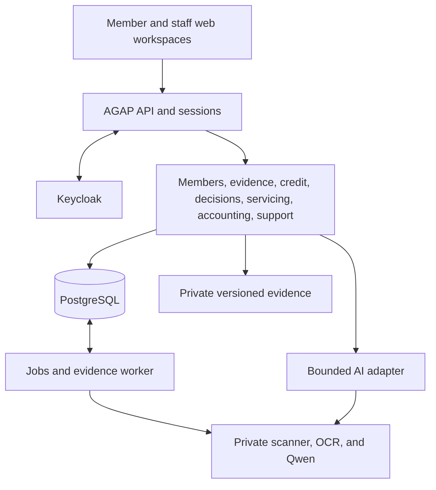

# AGAP architecture and production boundaries

AGAP is a modular monolith: a React frontend, a NestJS API, PostgreSQL, and a separate worker using shared domain modules. Keycloak establishes identity; private storage retains original and derived evidence. The supplied application is a fictional prototype with gated server workflows. [Verification](AGAP_Verification.md) distinguishes checked behavior from production obligations.

## 1. Architecture decisions

| Layer | Implementation and boundary |
| --- | --- |
| Web | React/TypeScript/Vite, hash routes, shared controls/tokens, and separate member/staff contexts |
| API | Node 24, NestJS modules, server-established actor contexts, versioned commands, and generated contracts/client |
| Database | PostgreSQL 18, append-only checksum-checked migrations, module-owned tables, scoped runtime roles and RLS |
| Identity | Keycloak OIDC/PKCE, separate staff/member sessions, own-record member links, and fresh MFA for sensitive actions |
| Evidence | Private filesystem or managed-identity Azure Blob adapter, immutable file versions, quarantine, scanner/OCR processing, and source-linked facts |
| Finance | One deterministic shared package; integer centavos and calendar dates; immutable input/result snapshots |
| Background work | PostgreSQL jobs/outbox and evidence processing leases; explicit retries and failed/unavailable states |
| AI | One reusable bounded adapter; pinned artifact/prompt/schema provenance; untrusted drafts and manual fallback |
| Models/evaluation | Offline training, independent release/evaluation tools, and large weights outside Git |

The domain boxes share one backend; they are not independently deployed services. Identity credentials/data are separate from loan/accounting records. The first deployment design serves one cooperative with explicit organization, branch, assignment, and member scopes.

## 2. Application modes and capabilities

- **Browser review demo:** fictional `CaseRecord` fixtures and versioned browser persistence. Staff-session entry protects access; Demo tools only simulates people and workflow roles.
- **Default server workspace:** persisted member/staff intake, separate member linkage/preferences, support workflows, and scoped reporting. Unconfigured domain capabilities remain unavailable.
- **Evidence workflow:** `EVIDENCE_WORKFLOW_ENABLED` activates evidence/credit services; private storage, processing services, approved configuration, and an organization-scoped worker are required.
- **Connected lending:** `CONNECTED_LENDING_ENABLED` supplies authoritative staff review, exact-term member acceptance, and pending origination in fictional non-production evidence mode. It is mutually exclusive with the pilot because they own the same decision/acceptance stream.
- **Fictional lifecycle pilot:** `FICTIONAL_PILOT_ENABLED` registers current-source review, decisions, acceptance, principal-only simulated servicing, accounting, and safe member projections. Activation rejects real records, production, disabled evidence, and automatic presentation sessions. Guarded temporary local password-only recording retains actual single-factor assurance; privileged commands still require MFA.

The current shared contract is 0.4.0. Historical 0.2/0.3 record meanings and stored assessment/decision versions remain readable. [Schemas](../packages/contracts/src/schemas.ts), [operations](../packages/contracts/src/operations.ts), [ports](../packages/contracts/src/ports.ts), and [generated OpenAPI](../packages/contracts/openapi.json) are the executable interface authorities.

## 3. Modules, data ownership and interfaces

| Module | Authoritative responsibilities |
| --- | --- |
| Platform/identity | Actor and member linkage, sessions, scope, transactions, audit, idempotency, jobs, and infrastructure |
| Members/applications | Member contacts/notices, application metadata, assignment, and revisions |
| Member portal | Own-record authorization/orchestration and UI; delegates financial/domain work |
| Evidence | Source/file versions, drafts, confirmed facts, independent verification, corrections, and clarification |
| Credit | Product/policy configuration, offers/schedules, checked cash flow, costs, and assessment history |
| Decisions | Current recommendations, conflicts/authority, review/escalation, immutable decisions, and exact-term member acceptance |
| Servicing | Loan/schedule versions, release/repayment commands, allocations, receipts, and posted position |
| Accounting | Balanced journals, source-event uniqueness, approved mappings, periods, and reconciliation |
| Monitoring | Confirmed support/check-ins, assignment, internal/member-visible responses, follow-up, and position freshness |
| AI | Bounded extraction/review transport and provenance; no domain or financial authority |

Modules write only their own tables through public services. Consequential orchestration passes the same transaction context across modules; it does not start nested transactions for a partial financial effect. The original assessment implementation lives in `packages/finance`; `src/domain/assessment.ts` remains a compatibility re-export. Owner boundaries and handoffs are in the [delivery plan](AGAP_Delivery_Plan.md).

## 4. Data model and versioning

Operational records use normalized tables and stable IDs with organization/branch/member scope. Records retain aggregate/input versions and effective/recorded dates. Evidence includes nullable values with unavailable reasons, amount period, gross/net basis, source/version, verification, explicit cash dates, and horizon coverage. Confirmation never implies independent verification.

Assessments preserve exact facts, policy, offer, horizon, engine version, checked results, and input hash. Decisions preserve that basis, recommendation, actual reviewers, explanation, and authority. Acceptance binds the exact document/terms. Material edits invalidate current review while retaining historical inputs and outputs; restoring old values does not restore approval automatically.

Financial events, receipts, schedule versions, journals, and support disclosures retain immutable history. A support request captures its submission-time position; a current-position read is separately authorized and dated. Model/dataset/release manifests bind immutable artifact, prompt, schema, source, and evaluation identities without storing operational member data in training tools.

## 5. Financial invariants and transaction boundaries

### Money and dates

Use safe integer centavos, explicit PHP, validated calendar dates, and deterministic rules. Missing is never zero. Preserve confirmed zero and policy-based not applicable separately. An included one-time fact with multiple cash dates makes the assessment incomplete. Avoid payroll, business-cost, household/spouse, reserve, and payment double counting.

`dated-cash-flow-v4` distinguishes modeled calendar-month segments from horizon net remaining. Contractual total repayment and financing cost include the full schedule/fees independently of horizon. Loan proceeds reserved for their purpose are not household spendable cash. End-of-day cash balances do not establish intraday ordering or future-event certainty. Historical engine versions retain their stored results.

### Accounting and payments

A financial posting updates servicing, allocations, receipt, journal, audit, and command result atomically. Approved mappings and an open period are prerequisites; journal debits equal credits. Permanent source-event uniqueness is separate from HTTP idempotency. Corrections use explicit reversal/adjustment history rather than editing a posted journal.

The supplied fictional product supports exact scheduled principal repayments with zero interest/fees/grace. Partial/general allocation, interest accrual, penalties, refunds, full reversals, capital, reporting, and close retain separate implementation/acceptance requirements. A provider timeout is an unknown outcome requiring reconciliation; it cannot trigger a second transfer automatically.

The small pilot serializes organization-material transactions before transaction identity/aggregate locks. HTTP session validation remains required before command entry. Evidence workers and policy/retirement operators take the same guard. This is a conservative fictional-pilot choice, not a production scalability result. Production concurrency/period-close behavior needs tests with the actual configured modules.

## 6. Commands, concurrency and review readiness

Server-established actors supply organization, scope, identity, and authentication strength. Request bodies cannot set their own actor, verified status, payment settlement, or calculated totals. Authorization/assignment are rechecked before command replay and within the transaction.

Consequential commands use `Idempotency-Key`; the same key/body replays the committed result, while changed content returns conflict. Updates use `If-Match`; missing/stale versions fail explicitly. Aggregate writes, revisions, audit/outbox, and saved responses share a commit. On an uncertain result, retry the same request/key. A browser cancellation or timeout is not proof that execution failed.

One current rule result supports queue, summary, and consequential guards. Readiness binds current sources, facts, offer/policy, assessment, recommendation, checked concerns, and escalation dispositions. Human-substantiated material concerns precede other cases, with stable snapshot-bound pagination. Notice acknowledgment does not clear a concern; reassignment/revocation removes former recipient access. Persisted review leases/receipts allow interrupted generations to be reconciled for manual checking.

## 7. Identity, documents and privacy

Staff/member OIDC state, callbacks, cookies, and principals are separate. Operator-verified issuer/subject linkage grants own-record member access; editable phone numbers, uploads, or provider role claims cannot grant membership. Sessions and active links are rechecked and locked through commands. Runtime users cannot be owners, superusers, or `BYPASSRLS` roles.

Use opaque HttpOnly sessions, origin/CSRF checks, bounded login attempts, and signed fresh MFA for sensitive actions. Scope checks apply to reads, commands, private downloads, jobs, and safe projections; RLS is an additional control. Members do not receive staff searches, CI notes, or internal support details.

Uploads use generated keys, bounded size/type/content checks, private quarantine, scanning, immutable original/derived versions, and authorized safe downloads. Scan/OCR/Qwen/storage calls run outside the short HTTP transaction under leased/fenced processing. A cleared file is not an authenticated claim. Retention/holds govern authorized disposal; immutable decisions do not justify retaining every document indefinitely.

Keep credentials, member payloads, raw documents, and tokens out of public assets/logs. Encrypt transport/storage/backups and keep independently recoverable keys outside Git. Consent, purpose, access/correction, retention, and approved external processing remain institutional release inputs.

## Structured guidance, recording and report extensions

Source/text-bound clarification events store partial answered/unknown/declined responses without changing financial versions. Final confirmation uses the existing fact command; stale source/text versions require renewed review. Shared generated contracts supply controls from structured missingness; model text cannot construct routes or trigger commands.

The recording module owns append-only prepared packets with restricted current-basis reads and a safe member recommendation projection. Operator preparation authors fictional packets; runtime cannot publish packets. Exact source, policy, assessment, and preparation identities bind the take. Normal OIDC sessions and own-member/branch scope remain authoritative. The shared deterministic engine calculates baseline/what-if results; authored narrative 5C findings do not become a trained-model output. The unprepared analysis preview's scripted percentages are not validated probabilities or institutional rubric scores.

Connected review uses versioned current-basis proofs and lossless decision snapshots, with exact unchanged explanation/terms before expiry. Acceptance binds immutable documents and never activates a loan before a posted release. The connected money workspace retains separately authorized simulation, exact retries, and reconciliation of unknown outcomes. No real provider is implied.

Accounting adds immutable trial balances over posted journals under organization-wide auditor scope and one consistent snapshot. Monitoring adds immutable linked corrections and staff-authored check-ins requiring member confirmation; neither changes contractual balances. Broader statements, close, capital, institutional rules, and independent acceptance remain separate.

## 8. Models, research and planned extensions

The extraction baseline and Experiment F qualitative review are distinct capabilities. A student-credit CPU experiment executed extraction → F review → disabled extraction offline with exact switching parity; extraction exceeded the live service budget, so this does not replace the CUDA/BF16 HTTP service or establish accepted operational inference. F's six-field output supplies human-review drafts, not financial facts. Private serving uses one base plus an unmerged adapter, serialized generation, and clean-base/disabled-adapter parity before readiness. Over-limit, failed, busy, or timed-out calls retain manual follow-up. [Experiment F documentation](../models/qwen/experiment_f/README.md) records exact artifact identities and execution limits.

Training and independent evaluation remain outside operational databases. Only a reviewed release can be promoted; the explicit fictional candidate gate supplies no institutional approval. EBM/logistic survey research ends in an offline report and has no path into member views, affordability, approval, support ranking, or financial commands. See the [training/evaluation plan](AGAP_Model_Training_Plan.md).

Goals/product guidance and institution-rubric numerical 5C review remain planned. They require reviewed catalogue/rubric rules, deterministic traces, consent/suitability controls, and separate evaluation; they cannot be inferred from the existing model service or research protocol.

## 9. Deployment, recovery and live-release gates

Local development uses Compose, PostgreSQL, Keycloak, private files, and fictional data. The institutional deployment preparation uses a same-origin frontend/API arrangement, Azure services, HTTPS identity, private Blob, and private GPU inference. The separate credit-only Linux pilot is described in [its guide](../infra/azure/pilot/README.md). Neither package establishes a deployed service or a free operating budget. Hardware, inference, external messaging, payments, and offsite backups may incur costs.

Real records require a checksum-bound institutional release, approved product/accounting/access/privacy rules, accepted models or manual fallback, actual processing/identity evidence, and responsible-user review. Complete recovery must consistently cover application and identity databases, document versions, configuration, and independently recoverable keys, with offsite restoration and reconciled cutover balances.

Live acceptance includes independent financial oracles; stale/concurrent decisions; duplicate/unknown/reversal/overpayment handling; subledger/GL and bank reconciliation; period-close races; cross-scope access; scanning/download access; operational monitoring; restoration; and an observed institutional workflow. A local test pass or a deployment template does not certify those requirements. Current evidence and blockers are in [verification](AGAP_Verification.md).
