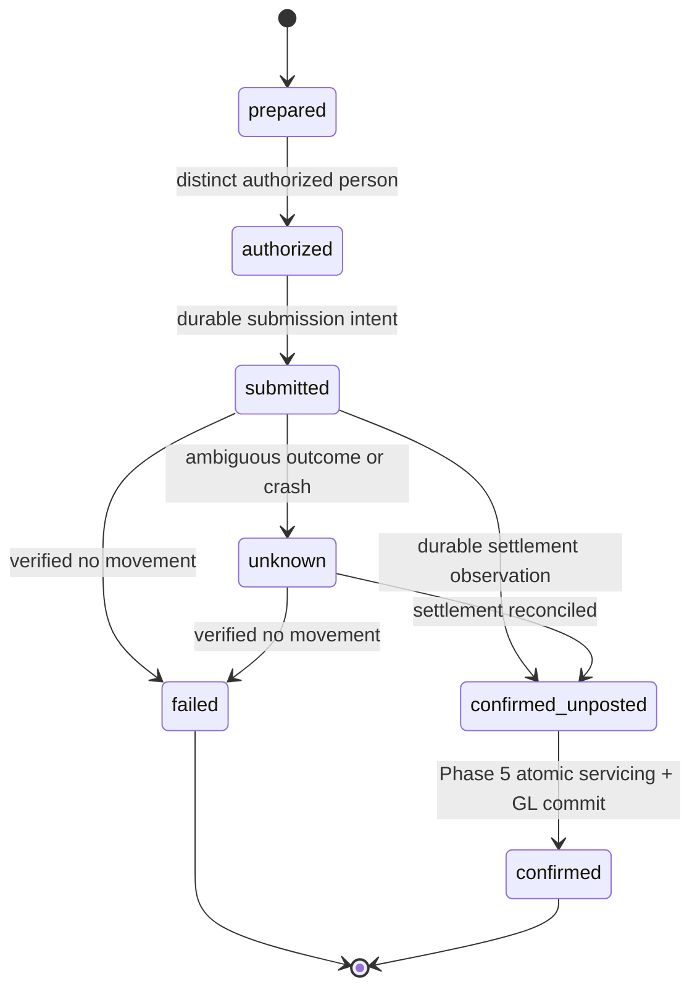

# PAY-01 Phase 4 — servicing records and durable command foundation

**Prepared:** 2 November 2026, Asia/Manila. **Owner:** Benedict. **Scope:** evaluation and implementation planning only; no servicing code, route, migration or financial operation is implemented by this package.

Follow [Assignment.md](../../../../Assignment.md#benedict), the [Benedict brief](../03-decisions-servicing.md), [product solution](../../../AGAP_Product_Solution.md), [production architecture](../../../AGAP_Production_Architecture.md), [delivery boundaries](../../../AGAP_Delivery_Plan.md), [frontend specification](../../../AGAP_Frontend_Spec.md) and [design.md](../../../../design.md). The earlier [fictional oracles](../../../AGAP_Product_Freeze.md#5-the-fictional-demonstration) remain unchanged. This plan sequences the existing PAY-01 assignment, not a new task tracker, accounting policy or design guide.

## 1. Purpose and inspected readiness

Phase 4 builds the durable records and controls required **before** a money path: an exact approved/accepted pending origination, immutable schedule, separately authorized command, durable submission/settlement observations, once-only release identity and recoverable command status. Phase 5 later connects actual servicing effects, Earl's posting service, receipts, positions and reconciliation atomically.

Inspected dependency: `9af25b5842f668c85be36964b62772b46b34544d` (`feat/benedict-dec-01-phase3`), containing Phase 2 `036bf58`. Main remains `1776d9fdd5022e141a48ba1fda318636637e3d85`. Canonical contracts remain **0.2.0**. These are inspected commits, not an agreed integration base. The [Phase 3 handoff](../benedict-phase3/IMPLEMENTATION.md) records an isolated candidate; it is neither merged nor connected to the normal app. The original uncommitted nine-phase definition was inspected separately and is fingerprinted in [source_manifest.json](source_manifest.json).

| Actual repository finding | Planning consequence |
| --- | --- |
| No `apps/api/src/modules/servicing/` implementation | Create this owned module after interface agreement; existing request types are not a loan/command database |
| Phase 2 `reviewBasis` always returns `releaseAuthorized: false` | Implement a real transaction-aware release guard after exact loan/command mapping exists. Never flip that read flag or treat it as `authorizeRelease` |
| `ReleaseAuthorizationPort.authorizeRelease(tx, loanId, commandId)` exists, with no connected implementation | Agree how decision authorization reads server-owned servicing bindings without a cross-module SQL shortcut or nested transaction |
| Financial command creation and seven command states exist in canonical schemas | Reuse their primitives. Explicit authorize/submit/confirm/recover/read contracts, command kind, simulation provenance, evidence and durable identities are still gaps |
| `/disbursements`, `/payments`, loan-position operation remain `implemented: false`; servicing capability is `contract_only` | No route/flag activation from a local constructor or a plan. Robert owns shared registration/client changes |
| Earl's [GL-01 service](../../../../apps/api/src/modules/accounting/README.md) is transaction-aware and has a period pre-lock helper | Consume its public service/helper in the later atomic path. Never write accounting tables, create another GL or lock a loan before acquiring a required period lock |
| GL-01 fictional mappings and ACC-01 checker cover principal movements | Do not silently process interest/fees through principal-only accounting. A posted demonstration needs approved matching components or an explicitly separate principal-only fixture |
| ACC-01 treats `confirmed` as posted and `confirmed_unposted` as an exception; provider outcome also has a `confirmed` label | Settlement confirmation and posted command success must be distinguished explicitly |
| `LoanPosition` requires `postedThrough`; member loan status has no pending-release variant | Do not fabricate a posted timestamp/zero position or label an unreleased loan active merely to fit existing schemas |

Phase 4 planning, pure rules and candidate persistence tests can advance independently. Connected release readiness requires real decision/current-source/application/identity guards and accepted contracts. Phase 3's screen integration is not a prerequisite for pure command work, but a simulated screen or test adapter cannot substitute for actual decision authorization.

## 2. Scope, invariants and exclusions

The core invariant is: **one initial release for one authorized origination, acknowledged against exact immutable terms, with a separately authorized durable command; the loan becomes active only when its known settlement and servicing/GL effects commit as posted.**

Required behavior:

- A pending loan preserves organization/branch/member/application, decision/snapshot, acceptance/document/checksum, product/offer/policy/schedule and current-input bindings. Reuse Aaron's approved schedule and supplied amounts; no new schedule/interest calculator or AI authority.
- Proposed origination uniqueness must cover the application/decision-to-loan mapping as well as release-per-loan. Otherwise another loan ID or renewed decision could bypass a loan-only first-release constraint. Preserve history; no automatic new pending loan or silent rebind after source/terms change.
- Missing or stale approval/acceptance, expired terms, unresolved restriction, unsupported authority or unavailable provider/mapping blocks a **new consequential action**. It never becomes a guessed approval or a zero amount.
- Cash movement facts and permission to initiate a new movement are distinct. Once movement is known, authorized observation intake must preserve it even if posting/approval conditions later fail. Keep an exception instead of losing the fact or pretending the money did not move.
- Use safe integer centavos/PHP, valid calendar dates, server UTC instants and explicit Manila business dates. Preserve contractual date, movement/effective date, recorded time and posting date separately. Amount/effective-date changes invalidate authorization; no arbitrary state or balance PATCH.
- Keep a stable HTTP retry identity, durable logical command/provider key, and permanent business-event identity. Notification/attempt IDs are additional transport evidence, never substitutes for the underlying movement identity.
- Real staff identity, current scope and configured authority govern every action. Cashier preparation and distinct financial authorization are separate from loan approval, member acceptance and accounting posting. Administrator/accountant membership alone does not authorize releasing money.

Phase 4 has no real bank/provider call, cash transfer, repayment allocation posting, active-loan declaration, receipt claiming posted success, member-phone implementation, numeric 5C scoring, model runtime, amendment/refund/reversal implementation or new accounting/monitoring writes. It can model/test a **clearly fictional manual driver** and posting preconditions. Actual atomic posting and complete positions are Phase 5; broader financial treatments remain their existing tasks.

## 3. File and team ownership

| Owner | Responsibility in this phase | Boundary |
| --- | --- | --- |
| Benedict | Planned `apps/api/src/modules/servicing/`: pure command rules, repositories/services, owned migrations, guarded reads, fixture-only manual driver and tests; decision-owned release-authorization implementation after accepted interface | No source/application/identity/accounting SQL writes outside the owning public service. Preserve Phase 1–3 snapshots and applied migrations |
| Robert | Canonical schemas/ports/client/OpenAPI, identity/application helpers, global lock/recovery orchestration, worker/app/provider/migration/capability registration, shared config/dependencies and central tracker | Benedict supplies concrete proposals; one writer for each shared file. This plan does not amend contracts or task status |
| Aaron | Approved offer/schedule/policy, cash/principal/fee component interpretation, current source/input guards and finance | No copied schedule engine or local interpretation of interest/allocation rules |
| Earl | GL-01 period locking/posting/configuration, ACC-01 evidence reader/report/comparison, monitoring/accounting | Consume `PostingPort`, `lockPostingPeriod` and reviewed evidence interfaces; never patch his tables/tests or copy his reconciliation engine |
| Cooperative's responsible officers/accountant | Effective permissions/limits/MFA, manual confirmation evidence, expiry, recognition/allocation and disclosure | Development fixtures remain fictional; missing institutional settings block affected live operations |

Proposed owned files: `servicing/context.ts`, `command-rules.ts`, `command-rules.test.ts`, `servicing.repository.ts`, `servicing.service.ts`, `release-guard.ts`, `command-reads.ts`, `manual-simulation.ts`, module `migrations/` and focused DB/runtime/recovery tests. Exact names follow implementation needs; do not create empty scaffolding just to match this list. New assigned staff loan/payment screens are Phase 5; existing centralized appearance/controls remain authoritative when those screens are built.

Retain Node 24/npm 11.9.0, TypeScript/NestJS/PostgreSQL, existing unit of work, command/idempotency helpers and audit/outbox. No new ORM, queue, finance library or provider SDK is justified for this foundation.

## 4. Contract decisions required before affected integration

All additions below are **proposals**. Robert owns canonical publication/generated outputs; 0.2.0 does not already supply them.

| Boundary | Decision/input required | Receiving owners |
| --- | --- | --- |
| Pending origination | Explicit application/decision/acceptance/document/immutable-schedule identity, unique pending origination, server derivation of principal versus delivered cash and no active status before posting | Robert/Aaron/Benedict |
| Decision release guard | Current saved approval and exact acknowledgment, current inputs/source/policy/offer, expiry/conflicts, loan/command binding and transaction guard shared with writers | Benedict with Robert/Aaron |
| Financial authorization | Prepare/authorize/submit permissions, action/product/branch/amount/date applicability, separation, freshness/MFA, original authorizer recheck and immutable authorized payload hash | Robert/Benedict with policy owners |
| Command lifecycle | Explicit typed operations and reads with expected command version, stable idempotency and safe error/recovery semantics; no request-controlled next state | Robert/Benedict |
| Settlement observation | Trusted producer/method/movement identity, linked command, amount/currency/date, evidence version/checksum, observation actor/time, simulation mode and contradictory-evidence handling | Robert/Benedict; Earl consumes exceptions |
| No-reference recovery | Existing provider port can return `unknown` with null reference, but `getStatus` requires a string | Robert/Benedict must add accepted key-based lookup or leave operator reconciliation required; never invent a reference or automatically resubmit |
| Posting prerequisite | Earl's accepted period pre-lock/helper, permanent source event and mapping version; no post success from a provisional journal receipt before commit | Earl/Robert/Benedict |
| Position/reconciliation handoff | Posted-only position/freshness and complete event/allocation/receipt/journal inventories, scope/cutoff/snapshot, including orphan/unmatched records | Benedict/Earl/Robert; operational reader is Phase 5 |

Preserve the existing `ReleaseAuthorizationPort` signature where practical. Proposed implementation: servicing exposes a narrow transaction-aware immutable loan/command binding read; the decision service consumes that accepted port and current owner guards, never servicing SQL directly. Servicing calls `authorizeRelease` with real stored IDs after acquiring the agreed locks. The read must not call back into financial orchestration or open another unit of work. If owners prefer a basis-taking signature instead, Robert publishes that revision first; neither alternative is silently accepted by this document.

The existing Phase 2 `reviewBasis` opens a staff unit of work and does not authorize release. It cannot be called as a nested transaction inside money orchestration. Refactor/extend through an owned transaction-aware authorization boundary once its producer contract is agreed; preserve the existing non-authorizing read.

Resolve delivery amount semantics explicitly. Principal, net proceeds, separately paid/withheld fees, contractual repayment total and actual settled cash are different values. Do not copy `principalCentavos` into every disbursement amount or infer an interest split from total financing cost. A principal-only Phase 5 fixture needs separately approved compatible terms/mappings. The canonical Ana example (₱30,000 received, ₱36,000 repaid) cannot become a fully processed principal-only repayment by dropping the financing component; preserve that oracle and either implement the missing treatment or use a separately reviewed fictional example.

## 5. Proposed durable records

These are logical tables, not accepted canonical schemas. Normalize mutable pointers/versions and immutable evidence/history; composite scoped keys, constraints and narrow grants enforce the boundaries.

| Record | Minimum preserved data / invariant |
| --- | --- |
| Pending loan/origination | Org/branch/member/application, unique origination identity, saved approval/acceptance/document/hash references, offered principal/delivered amount/currency, schedule version, guarded revision and pending-release state |
| Schedule version/rows | Exact producer-supplied dates/components/amounts, offer/product/policy/engine identity and checksum; original version never rewritten. Unsupported missing components stay unavailable |
| Release intent/claim | One logical first-release identity per origination/loan, bound decision/schedule, current command and final consumed event reference; block another key/command/loan/decision from creating a duplicate release |
| Financial command | Server operation kind, immutable monetary/effective-date/method/reference/reason payload and hash, current version/state, preparer/authorizer, stable logical/provider key and outcome references |
| Authorization/transition history | Actor/role/scope/configuration/MFA evidence references, exact approved payload/version, reason, server time and old/new state; no ordinary history UPDATE/DELETE |
| Submission attempt | Durable intent/attempt ID committed before side effect, command/provider-key binding, lease/claim/fencing revision and sanitized response/status provenance. Expired lease is not proof of no transfer |
| Settlement observation | Permanent producer/movement identity and observation ID, exact command/event link, amount/date/reference/evidence hash, actor/time and explicit simulated/actual provenance; append-only deduplication and contradiction evidence |
| Servicing business event | Permanent source-event identity, loan/kind, supplied movement components, state and future journal/receipt/allocation references. An unposted event is not a loan-balance change |
| Allocation/receipt linkage | Define keys/immutability now for Phase 5; do not create posted allocations or member receipts during Phase 4. Acknowledging movement evidence is not a posted loan-payment receipt |

Runtime roles are not schema owners/superusers/BYPASSRLS. Enforce org/branch/member linkage, scoped composite references, safe versions/centavos, uniqueness and immutable histories in SQL plus services. Reuse shared HTTP idempotency/audit/outbox stores; do not create a second platform command cache or queue. Worker/provider inbox registration stays with Robert.

No automatic replacement release is in the first foundation slice. A definitively failed command preserves history; any later replacement/re-authorization needs an accepted linked protocol and the same origination first-release invariant. Unknown/known-settled commands can never be replaced just because an operator chooses a new key. No canceled/posted public state is invented to extend the current enum.

## 6. Proposed command semantics and state machine

For this handoff, `ProviderOutcome.state = confirmed` means **settlement observed**, while `FinancialCommand.state = confirmed` means **posted success**. This agrees with Earl's current ACC-01 comparison. Record settlement durably as `confirmed_unposted`; only Phase 5's atomic orchestrator may produce posted `confirmed`. Robert/Earl must accept this interpretation before connected endpoints depend on it.

The detailed proposed [transition matrix](transition_matrix.csv) defines actors, evidence, version checks, transaction effects and forbidden shortcuts. Invalid requests leave the prior state unchanged. Blocked/stale authorization is not automatically a `failed` settlement outcome. Same-key replay is not a new transition; later status is obtained through a separate authorized read.

Phase 4 can demonstrate prepared → authorized → submitted → unknown/failed/confirmed_unposted using a labeled fictional manual driver. It must reject a final `confirmed` transition without actual transactionally linked posted evidence; unit doubles for that precondition are not Phase 5 posting evidence. Do not create an active loan or green fully-paid result to complete a demo state machine.

## 7. Implementation work packages

### P4-A — agree integration basis and concrete contracts

1. Recheck main, Phase 2/3 candidates, official assignments and Earl's posting/reconciliation implementation. Record the actual accepted dependency commits and canonical revision; a branch name is not acceptance. Preserve all existing worktrees, training files and partner documents.
2. Review sections 4–6 with Robert/Aaron/Earl. Agree command-state meaning, one origination/first-release identity, transaction-aware release mapping, actor/MFA permissions, settlement observation and recovery reads. Record unresolved decisions in owned handoff evidence.
3. Select the bounded fictional manual demonstration and allowed financial components. Confirm no implicit interest/fee calculation or mapping. Set a capacity estimate from real owner availability; this phase is part of PAY-01's existing allocation, not a new calendar promise.

**Deliverable:** contract/base/lock decision record and scoped fictional fixture agreement. **Gate:** pure rules may use explicit proposals; real persistence/integration must use accepted producer boundaries rather than guessed settings.

### P4-B — implement pure origination, authorization and command rules

1. Reuse canonical IDs/centavos/currency/dates/states. Define server-owned command kind and immutable payload binding; parse complete/unavailable inputs without replacing missing values with zero.
2. Define exact approved/accepted pending-loan basis and one first release. Changed terms/current inputs require renewed review and hold a new action; preserve the old snapshots and any existing unknown/settled intent.
3. Require real scoped cashier/preparer and a distinct configured financial authorizer, including multi-role same-person denial. Check configured action/amount/date limits and current MFA/freshness via Robert's owner boundary; no fake actor/session for posting.
4. Implement the transition matrix and definitive versus unknown outcome rules. Amount/date/method/reference changes require a fresh authorized command, not an update to an authorized payload. Return stable errors suitable for existing precondition/retry behavior.
5. Test all guards and illegal transitions with independent fictional expectations. Use the existing engine/producer for schedules; do not copy canonical fixtures or a calculator.

**Deliverable:** pure rules/specification and meaningful tests. **Gate:** unsupported release, self-authorization, stale basis and ambiguous-outcome replacement are rejected without a provider/model.

### P4-C — add owned persistence and least-privilege boundaries

1. Implement reviewed module-qualified additive migrations under `servicing/migrations/`. Do not rewrite Phase 1–3 or Earl's SQL. Robert alone registers the module/order and reviews new schema startup ownership checks.
2. Persist pending origination/schedule, release identity, command/version, immutable authorization/transition/attempt/observation history and business-event links. Enforce uniqueness across origination and first release, not just a UI flag or one HTTP request.
3. Use FORCE RLS/narrow functions where needed, fixed search paths and revoked PUBLIC privileges. Prevent direct runtime history/state/balance patches and cross-org/branch/member references. Members receive no financial-command or accounting write access.
4. Add real runtime-role tests for inserts/reads/transitions, immutable history, key/reference constraints, revocation and non-superuser function ownership. Failure must roll back command claim/state/history/audit together.

**Deliverable:** servicing repository/migrations and actual DB evidence. **Gate:** constraints enforce business identity and access under runtime roles; a privileged setup connection or mock is not proof.

### P4-D — connect exact pending-loan basis and release guards

1. Obtain accepted immutable decision/acceptance/document and schedule basis through owner services. Membership acknowledgment precedes pending origination; avoid a circular requirement for a preexisting loan before accepting terms.
2. Create/read one scoped pending origination idempotently, preserving exact stored references and supplied amounts. No browser-generated actor, snapshot, authoritative total or `active` status is accepted.
3. Implement `authorizeRelease` against real server-owned loan/command mapping and current decision/source/policy/conflict/expiry guards in the caller's transaction. Recheck immediately before authorization and consequential submission; prior approval alone is insufficient.
4. Reconcile decision/application/source locks with the financial order in section 8. Fail closed on missing adapters/settings; retain the existing non-authorizing `reviewBasis` behavior.
5. Test stale/expired/superseded approval, wrong member/document, no acknowledgment, unknown prior release, alias loan IDs and concurrent attempts with real controlled DB writers. Actual source guard tests require real Aaron/Robert producers before connected claims.

**Deliverable:** guarded pending-origination service and transaction-aware decision boundary. **Gate:** one current exact accepted basis, no duplicate release via a second ID, and no active-loan effect.

### P4-E — implement durable prepare/authorize/submission intent

1. Use existing staff unit of work, scoped authorization and `command` helper. Authorize current resource access before replay; bind original operation/resource/body/version in the cache hash. A new attempt checks the current command version; an identical committed retry returns its original receipt.
2. Commit command/release claim, authorization/transition history and audit/outbox atomically. Financial authorizer remains distinct from preparer even if either holds several roles. Revalidate original authorizer applicability through the accepted identity/config port at the required consequential boundary.
3. Persist the immutable submission attempt/provider key and dispatch claim **before** invoking any external effect. Do not hold a DB transaction open across a provider call. This phase invokes only the explicitly fictional driver; real provider and unattended worker registration remain disabled.
4. Serialize competing workers/operators with a version/claim/fencing token. Reclaiming an expired lease authorizes status reconciliation, not a second transfer. No normal outbox retry handler blindly submits money.
5. Inject crashes before intent commit, after intent commit/before simulated call and after simulated call/before response persistence. Recovery must retain uncertainty where it cannot prove no movement; a 404 or empty local response is insufficient.

**Deliverable:** durable command services and one-effect retry/claim tests. **Gate:** command intent survives restart and uncertainty cannot produce another logical release.

### P4-F — persist settlement observations and safe recovery

1. Define a necessary evidence/provenance envelope for authorized manual observations. The driver emits unmistakable simulation mode and stable fictional movement IDs; cash/bank labels do not pretend to electronically move money. Real evidence permissions/retention remain policy inputs.
2. Commit authenticated/authorized settlement observations separately from later posting. Deduplicate exact transport notifications and the underlying producer/movement identity; arbitrary free-text instrument references alone are not sufficient movement identity. Same identity with different amount/currency/date is a conflict preserving original evidence and a visible exception.
3. On known settlement, persist `confirmed_unposted` and event link even when a posting period closes or authorization/data subsequently changes. Intake permission to document the known fact is distinct from permission to initiate a new release. No compensation deletes the known movement.
4. Provide scoped command/history/status/recovery reads. Reconcile `unknown` through verified status/evidence. If provider reference is null and no accepted key-based query exists, leave unresolved for authorized operator review; no invented reference or automatic resubmission.
5. Preserve late/duplicate/contradictory outcomes. A late failure cannot downgrade known settlement/posted success; a confirmed-but-unposted retry schedules posting recovery only. Failed-command replacement, cancellation, reversal and changed terms require their separately agreed workflows.

**Deliverable:** durable observation/recovery services and crash/duplicate tests. **Gate:** observation survives a later failure and new keys cannot erase or repeat it.

### P4-G — prepare the Phase 5 accounting/read handoff

1. Agree `lockPostingPeriod`/`PostingPort` use and versioned fictional mappings with Earl/Robert. Confirm that accounting role eligibility does not replace release preparation/authorization separation.
2. Specify the Phase 5 atomic boundary: event claim, allocations/subledger, synchronous Earl posting, receipt/journal references, command `confirmed`, release-claim consumption/loan activation and audit/outbox commit together in the caller's unit of work. A journal replay must not apply servicing effects again.
3. In Phase 4 keep that consequential finalize operation unavailable without actual posted evidence/orchestrator. A double can verify expected calls/rollback contract only; no invented journal ID or receipt marks success.
4. Define future reconciliation inventories with permanent event/loan IDs, explicit principal/interest/fee/unapplied components, effective/recorded times, command status and receipt/journal/rule links. Preserve unmatched/orphan records and agreed consistent snapshot/cutoff/completeness semantics. Earl owns the comparison/report reader.
5. Keep member loan/posted-position/receipt projections unavailable where no posted facts exist. Do not fill `postedThrough` with now, missing components with zero or pending-release status with active. Robert publishes any needed contract change.

**Deliverable:** concrete Phase 5 service/locking/evidence handoff, not a posted money demonstration. **Gate:** no unsupported allocation treatment, asynchronous GL success or fake posted balance.

### P4-H — verify the foundation and hand off registration

1. Execute the [planned acceptance cases](acceptance_tests.csv) by layer: pure rules, runtime DB/RLS, two-connection races, crash/restart recovery, then registered HTTP where actual dependencies exist. Mark simulations and owner doubles explicitly.
2. Run focused tests, `npm run check`, then `npm run test:e2e` sequentially on a dedicated fictional `agap_test` database and isolated project/ports. Capture actual Node/npm/environment/base, test counts and failures; do not reset another developer's database. Passing old UI regressions alone cannot prove servicing works.
3. Record the fictional driver trace through prepared/authorized/submitted/unknown or `confirmed_unposted`. Assert no real network submission, active loan, posted receipt/journal/balance or falsely available capability. No UI changes/screenshots are required unless an actual owned screen is separately included and reviewed.
4. Supply Robert the reviewed canonical/API/port/client/migration/provider/worker/capability proposals and exact module exports. Integration cannot be declared until he wires actual owner adapters and the combined authorization/transition/recovery tests pass.
5. Update owned specification/verification with PAY-01, paths, dependency commits, test evidence and unresolved policy inputs. Robert updates `Assignment.md`; do not create another active tracker. Use `graft`/`graphify` if available and report actual availability. Push/merge remains separately authorized.

**Deliverable:** review-ready durable-command foundation with actual verification and a separately gated connected integration. **Gate:** every claimed path has its real evidence; known settlement remains recoverable and cannot be duplicated.

## 8. Proposed lock and transaction protocol

The canonical financial segment remains **accounting period → affected loans sorted by ID → financial command/business-event locks** inside the real identity-authorized coordinator. Earl's posting helper is acquired before a loan lock whenever the operation may post. Calling his posting function later cannot repair an already inverted lock order.

Proposed combined order for owner review:

1. Coordinator's current identity/session locks; additional financial-authorizer/configuration checks use Robert's public boundary.
2. Authorized immutable origination lookup for identity only, then agreed application/source/policy/decision guard in the same order as DEC-01 writers.
3. Required accounting period pre-lock for the posting transaction; no posting-period lock is required merely to record known settlement evidence.
4. Sorted loan/origination locks, then command/release/business-event/attempt locks in a deterministic order.
5. Earl's bounded posting/configuration locks through his public service, followed by the single coordinator commit.

This ordering is **not accepted yet**. Robert/Aaron/Earl/Benedict must verify it against all source/decision/period/loan writers and test both race orders before integration. No writer may acquire a loan and then call an owner helper that acquires the earlier decision/application or period lock. A read-before-lock mapping must be immutable/scoped and revalidated after the required locks; a cached hash or asynchronous hold notification is not concurrency proof.

Use separate transactions for durable submission intent, external execution/status lookup outside DB, durable observation intake, and eventual atomic posting. Nested coordinators are prohibited. If recording observation succeeds but posting fails, retain the observation and `confirmed_unposted`; if intent persistence fails, the driver must not be invoked.

## 9. Work that can advance now and merge sequence

| Work | Can start now? | Integration prerequisite |
| --- | --- | --- |
| This plan, state/recovery proposals and pure-rule scenarios | Yes | Explicit review before calling proposals canonical |
| Pure command rules with labeled fictional inputs | Yes | Accepted field/authority semantics for real service integration |
| Repository/migration candidates | After accepted persistence/port boundaries; otherwise proposal only | Robert's actor/registration and cross-module reference/lock agreement |
| Transaction-aware release authorization and real pending origination | Only against actual accepted owner ports | Exact DEC-01 acceptance/document/current-source guard plus immutable servicing mapping |
| Fictional manual driver/restart tests | Yes against clearly labeled doubles | Actual authoritative services for connected readiness |
| Real external transfer or full posted payment | Outside Phase 4 | Phase 5 atomic service, component mappings and all applicable operating controls |
| Model/5C/monitoring work | Independent existing tasks | Does not block the template/command foundation |

Implementation sequence: P4-A → P4-B/C → P4-D/E/F → P4-G/H. Develop consumer rules and scenarios while integrations are pending; do not bypass actual financial guards. Use a new PAY-01 task branch/worktree from the eventual accepted base, preserving the unmerged Phase 1–3 work. If stacked, name its exact parent commits and integration gaps in the PR.

Merge order: Robert's accepted canonical/identity/lock changes; actual Aaron/DEC-01 producer guards; Benedict's owned rules/migrations/services/tests; Earl/Robert accepted posting configuration/public integration boundaries; shared registration and combined tests. Earl's real posting service remains a Phase 5 dependency for posted success, rather than blocking Phase 4's pure rules on a complete ledger product. Do not cherry-pick another owner's shared edits or rewrite their applied SQL to remove a conflict. Keep one writer per file, preserve main, and obtain user authorization before any merge.

## 10. Phase 4 completion criteria

The accepted foundation has exact pending-origination bindings, database-enforced one-release identity, immutable schedule/authorization/attempt/observation history, explicit permitted command transitions, real scoped preparation/separate authorization, durable uncertainty/status recovery and known-settled-but-unposted preservation. Claimed candidate versus connected tests, adapter simulation, actual ownership approvals and remaining registration are explicit.

A passing Phase 4 does **not** mean funds were transferred, a loan is active, a repayment is posted or Phase 5 reconciliation is complete. Those outcomes require the later atomic path and its actual evidence. This package is planning only; [VERIFICATION.md](VERIFICATION.md) records documentation checks, and every acceptance/transition record remains proposed rather than an implemented control.
